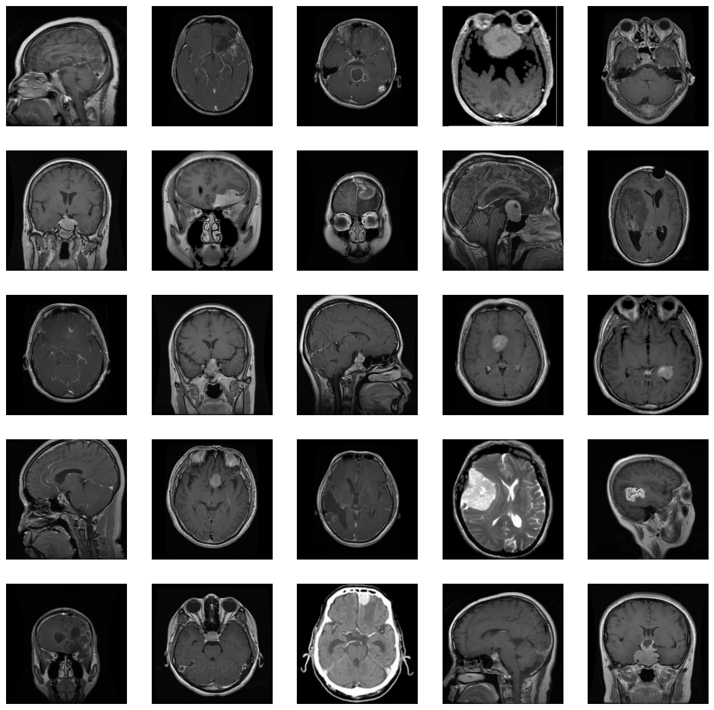
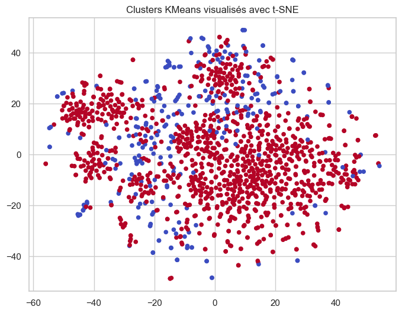

# Analyse semi-supervisée d'images IRM cérébrales

> Projet d'exploration de méthodes d'intelligence artificielle appliquées à
> l'analyse d'images médicales.

## Sommaire

- [1. Contexte et objectif](#1-contexte-et-objectif)
- [2. Question métier](#2-question-métier)
- [3. Données](#3-données)
- [4. Approche générale](#4-approche-générale)
- [5. Déroulement du notebook](#5-déroulement-du-notebook)
- [6. Méthodes étudiées](#6-méthodes-étudiées)
- [7. Résultats](#7-résultats)
- [8. Installation](#8-installation)
- [9. Exécution](#9-exécution)
- [10. Organisation du dépôt](#10-organisation-du-dépôt)
- [11. Reproductibilité](#11-reproductibilité)
- [12. Limites](#12-limites)
- [13. Pistes d'amélioration](#13-pistes-damélioration)

## 1. Contexte et objectif

L'entreprise développe des solutions basées sur l'intelligence artificielle
pour assister les professionnels de santé dans l'analyse d'images médicales,
notamment les IRM. Dans ce contexte, ce projet étudie la détection binaire
d'images cérébrales présentant ou non une tumeur :

- `cancer` : image annotée comme présentant un cancer ;
- `normal` : image annotée comme ne présentant pas de cancer.

L'enjeu principal est celui d'un contexte réaliste où les annotations
médicales sont coûteuses : le jeu de données contient peu d'images annotées,
mais un volume beaucoup plus important d'images sans étiquette. Le projet
cherche donc à déterminer dans quelle mesure les images non annotées peuvent
compléter l'apprentissage supervisé.

L'ensemble de l'analyse est regroupé dans le notebook
[`p10.ipynb`](./p10.ipynb). Le fichier [`main.py`](./main.py) est uniquement
un point d'entrée minimal et ne lance pas le pipeline du notebook.

> **Important — usage médical**
>
> Ce dépôt est un travail expérimental et pédagogique. Il ne constitue ni un
> dispositif médical, ni un outil de diagnostic, ni une recommandation de
> prise en charge. Les scores présentés ne doivent pas être utilisés pour
> prendre une décision clinique.

## 2. Question métier

La question étudiée peut être formulée ainsi :

> Peut-on exploiter un grand nombre d'IRM non annotées, en complément d'un
> petit échantillon annoté, afin d'améliorer la classification `cancer` /
> `normal` ?

Le projet compare trois scénarios :

1. **Supervisé** : apprentissage uniquement sur les images annotées ;
2. **Semi-supervisé** : utilisation de pseudo-étiquettes produites à partir
   des données non annotées, avec filtrage par confiance ;
3. **Active Learning** : sélection d'exemples jugés informatifs ou incertains
   afin d'enrichir progressivement l'ensemble d'apprentissage.

Avant la classification, plusieurs méthodes non supervisées sont également
testées pour vérifier si les représentations d'images forment spontanément des
groupes correspondant aux deux classes.

## 3. Données

### 3.1 Structure attendue

Le notebook utilise des chemins relatifs à la racine du projet. La structure
attendue est la suivante :

```text
mri_dataset_brain_cancer_oc/
└── mri_dataset_brain_cancer_oc/
    ├── Jeu de Données d'Images Cérébrales pour la Détection de Tumeurs.txt
    ├── avec_labels/
    │   ├── cancer/
    │   │   └── *.jpg
    │   └── normal/
    │       └── *.jpg
    └── sans_label/
        └── *.jpg
```


### 3.2 Répartition observée

L'exploration effectuée dans le notebook compte :

| Sous-ensemble | Nombre d'images | Utilisation |
| --- | ---: | --- |
| `avec_labels/cancer` | 50 | apprentissage et évaluation supervisés |
| `avec_labels/normal` | 50 | apprentissage et évaluation supervisés |
| `sans_label` | 1 406 | clustering, pseudo-étiquettes et active learning |
| **Total** | **1 506** | |

Les images examinées sont des fichiers JPG, généralement en RGB et de taille
`512 × 512`. Le notebook vérifie toutefois le format, la taille et le mode
de chaque image avant de poursuivre.

### 3.3 Étiquettes numériques

Les classes sont encodées dans le notebook de la manière suivante :

```text
normal -> 0
cancer -> 1
```

Les chemins des images annotées sont regroupés dans `labeled_paths` et leurs
étiquettes dans `labeled_labels`. Les images non annotées sont regroupées dans
`unlabeled_paths`.

### 3.4 Données sensibles et provenance

Le dépôt ne documente pas de métadonnées patient ni de protocole clinique.
Avant toute utilisation dans un contexte réel, il faudrait notamment vérifier
la dé-identification, les droits d'utilisation, la provenance des images, la
représentativité des populations et l'absence de doublons entre les
ensembles d'apprentissage et d'évaluation.

## 4. Approche générale

Le pipeline peut être résumé comme suit :

```text
Images JPG
    |
    v
Contrôle qualité et exploration
    |
    v
Égalisation d'histogramme + resize 224x224 + normalisation ImageNet
    |
    v
ResNet-50 pré-entraîné (dernière couche retirée)
    |
    v
Embeddings d'images
    |----------------------|
    |                      |
    v                      v
PCA / t-SNE            Classification
K-Means / DBSCAN       supervisée
Agglomerative          semi-supervisée
                       active learning
```

L'extraction des représentations est faite avec un ResNet-50 pré-entraîné sur
ImageNet. La couche finale de classification est remplacée par une identité,
de sorte que le réseau sert d'extracteur de caractéristiques. Les vecteurs
obtenus sont ensuite standardisés avant les algorithmes de clustering ou les
modèles de classification.

## 5. Déroulement du notebook

### 5.1 Exploration des images

Le notebook commence par :

- parcourir les fichiers image avec `pathlib` ;
- ouvrir les images avec Pillow ;
- relever le nom, la classe, la taille et le mode couleur ;
- compter les images par classe ;
- afficher des grilles d'échantillons ;
- inspecter visuellement un exemple individuel.

Cette étape permet de détecter rapidement des fichiers illisibles, des
dimensions inattendues ou une organisation incorrecte des dossiers.

### 5.2 Prétraitement

La transformation appliquée à chaque image est :

1. conversion en RGB ;
2. égalisation de l'histogramme ;
3. redimensionnement en `224 × 224` ;
4. conversion en tenseur PyTorch ;
5. normalisation avec les statistiques ImageNet :

```python
mean = [0.485, 0.456, 0.406]
std = [0.229, 0.224, 0.225]
```

L'égalisation est réalisée avec OpenCV. Pour une image couleur, elle est
appliquée sur le canal de luminance dans l'espace YUV ; pour une image en
niveaux de gris, elle est appliquée directement.

### 5.3 Extraction des embeddings

Le notebook charge les poids `ResNet50_Weights.IMAGENET1K_V2`, passe le réseau
en mode évaluation et extrait un vecteur pour chaque image. Les trois
résultats intermédiaires sont enregistrés au format NumPy :

| Fichier | Contenu |
| --- | --- |
| `features_labeled.npy` | embeddings des 100 images annotées |
| `labels.npy` | étiquettes `0` / `1` des images annotées |
| `features_unlabeled.npy` | embeddings des 1 406 images sans étiquette |

Ces fichiers sont déjà présents dans le dépôt, mais peuvent être régénérés
en exécutant les cellules d'extraction du notebook.

### 5.4 Réduction dimensionnelle

La PCA est utilisée pour représenter les embeddings dans un espace 2D et
visualiser la dispersion des images. Une représentation t-SNE est également
utilisée pour observer les proximités locales et colorer les points selon le
cluster obtenu.

Ces projections sont des outils de visualisation : elles ne remplacent pas
une évaluation quantitative et ne garantissent pas que les distances dans
l'espace 2D reflètent fidèlement celles de l'espace de caractéristiques.

## 6. Méthodes étudiées

### 6.1 Clustering non supervisé

Trois méthodes sont comparées :

- **K-Means** : partitionnement en un nombre fixé de groupes ;
- **DBSCAN** : recherche de zones denses, avec détection possible de bruit ;
- **Agglomerative Clustering** : construction hiérarchique de groupes.

Plusieurs valeurs de `k` sont testées pour K-Means et l'agglomération. Pour
DBSCAN, différentes valeurs de `eps` et `min_samples` sont explorées.

Même si le clustering est non supervisé, les 100 images annotées permettent
de calculer un **Adjusted Rand Index (ARI)** à titre d'évaluation externe.
L'ARI mesure l'accord entre les partitions prédites et les classes connues,
en corrigeant l'accord attendu par hasard.

### 6.2 Classification supervisée

Un classifieur est entraîné sur les embeddings annotés. Le notebook explore
notamment un perceptron multicouche (MLP), avec :

- séparation entraînement/test ;
- fonction de perte de classification ;
- pondération des classes dans certaines versions ;
- `LayerNorm` et `Dropout` dans les versions stabilisées ;
- comparaison de plusieurs configurations d'entraînement.

La classification supervisée sert de référence pour mesurer l'apport réel des
données non annotées.

### 6.3 Apprentissage semi-supervisé

Deux familles d'expériences apparaissent dans le notebook :

1. pseudo-étiquettes initiales produites par K-Means ;
2. stratégie de type **FixMatch**, dans laquelle :
   - le modèle produit une probabilité pour une image non annotée ;
   - la pseudo-étiquette n'est conservée que si la confiance dépasse un
     seuil, notamment `0,95` dans les expériences décrites ;
   - la perte supervisée et la perte non supervisée sont combinées ;
   - une pondération des classes peut être appliquée.

Cette approche permet d'utiliser les données sans étiquette, mais elle peut
aussi propager les erreurs du modèle lorsque les pseudo-étiquettes sont
incorrectes ou trop nombreuses.

### 6.4 Active Learning

La boucle d'Active Learning utilise les sorties softmax du modèle pour
identifier les exemples les plus incertains. Ces exemples peuvent ensuite
être intégrés à l'ensemble d'entraînement avec une pseudo-étiquette ou faire
l'objet d'une validation prioritaire.

Le notebook teste plusieurs paramètres de cette boucle, dont le ratio
d'exemples sélectionnés, le nombre d'itérations et la taille des batchs.

### 6.5 Mesures d'évaluation

Les expériences de classification affichent :

- **Accuracy** : proportion de prédictions correctes ;
- **F1-score** : compromis entre précision et rappel ;
- **Recall** : capacité à retrouver les cas positifs ;
- **AUC-ROC** : qualité du classement probabiliste ;
- **matrice de confusion** : détail des vrais/faux positifs et négatifs.

Dans un contexte de dépistage, le rappel et l'analyse des faux négatifs sont
particulièrement importants. Une accuracy élevée seule ne suffit pas à
qualifier un modèle médical.

## 7. Résultats

### 7.1 Comparaison du clustering

Les meilleurs ARI explicitement reportés dans le notebook sont :

| Méthode | ARI maximal observé |
| --- | ---: |
| K-Means | 0,1322 |
| DBSCAN | 0,0259 |
| Agglomerative Clustering | 0,0712 |

Ces valeurs sont faibles. Dans cette configuration, les embeddings issus du
ResNet-50 et le clustering ne suffisent donc pas à retrouver proprement la
séparation `cancer` / `normal`. C'est un résultat important : un grand volume
de données non annotées ne devient pas automatiquement exploitable par un
simple regroupement.

### 7.2 Comparaison des stratégies de classification

Le notebook contient plusieurs versions expérimentales. Un exemple de sortie
de la version stabilisée affiche les valeurs suivantes sur son jeu de
validation :

| Stratégie | Accuracy | F1 | Recall | AUC |
| --- | ---: | ---: | ---: | ---: |
| Supervisé | 0,950 | 0,957 | 0,917 | 1,000 |
| Semi-supervisé (FixMatch-like) | 0,950 | 0,957 | 0,917 | 1,000 |
| Active Learning | 0,950 | 0,957 | 0,917 | 1,000 |

Une autre exécution du notebook, avec une configuration différente, donne
des résultats distincts. Par exemple, une première version rapporte
`0,250` d'accuracy pour le semi-supervisé, contre `0,900` pour le supervisé
et `0,700` pour l'Active Learning. Cette variabilité est attendue avec
seulement 100 images annotées et montre qu'il ne faut pas retenir un score
isolé comme performance définitive.

### 7.3 Validation croisée exploratoire

Une expérience en cinq folds rapporte les résultats par fold suivants :

| Fold | Accuracy | F1 | Recall | AUC |
| ---: | ---: | ---: | ---: | ---: |
| 1 | 1,000 | 1,000 | 1,000 | 1,000 |
| 2 | 0,950 | 0,952 | 1,000 | 0,990 |
| 3 | 0,950 | 0,947 | 0,900 | 0,990 |
| 4 | 0,900 | 0,909 | 1,000 | 1,000 |
| 5 | 0,950 | 0,947 | 0,900 | 0,990 |

La moyenne de ces résultats exploratoires est proche de `0,950` d'accuracy,
mais elle doit être considérée avec prudence : les folds contiennent très peu
d'images et les images peuvent ne pas représenter la diversité d'un contexte
clinique réel.

## 8. Installation

### 8.1 Prérequis

- Windows, Linux ou macOS ;
- Python `>= 3.14` conformément à [`pyproject.toml`](./pyproject.toml) ;
- [`uv`](https://docs.astral.sh/uv/) ;
- suffisamment d'espace disque pour les données, les dépendances et les
  poids pré-entraînés de ResNet-50 ;
- idéalement un GPU compatible CUDA pour réduire le temps d'exécution.

### 8.2 Installation avec uv

Depuis la racine du dépôt :

```powershell
uv sync
```

Cette commande installe les dépendances verrouillées, notamment :

- `torchvision` et son écosystème PyTorch ;
- `numpy`, `pandas` et `pillow` ;
- `opencv-python` ;
- `scikit-learn` ;
- `matplotlib` et `seaborn`.

Jupyter n'étant pas déclaré dans les dépendances du projet, il peut être
ajouté uniquement pour l'exécution du notebook :

```powershell
uv run --with jupyter jupyter notebook
```

## 9. Exécution

### 9.1 Lancer Jupyter

```powershell
uv run --with jupyter jupyter notebook
```

Ouvrir ensuite [`p10.ipynb`](./p10.ipynb) et exécuter les cellules dans
l'ordre. Le répertoire courant doit être la racine du projet, car les chemins
du notebook sont relatifs :

```text
H:\python_project\projet10
```

Le chargement de ResNet-50 peut télécharger les poids ImageNet lors de la
première exécution. Une connexion Internet peut donc être nécessaire à cette
étape.

### 9.2 Ordre recommandé

Pour reproduire l'analyse complète :

1. installer l'environnement avec `uv sync` ;
2. lancer Jupyter depuis la racine ;
3. exécuter les cellules d'exploration ;
4. vérifier les chemins `dir_cancer`, `dir_normal` et `dir_unlabeled` ;
5. exécuter le prétraitement et l'extraction des embeddings ;
6. sauvegarder ou régénérer les fichiers `.npy` ;
7. exécuter les cellules de clustering ;
8. exécuter les expériences supervisées ;
9. exécuter les variantes semi-supervisées et d'Active Learning ;
10. comparer les métriques et les matrices de confusion.

Les blocs d'expérimentation sont coûteux : l'extraction des embeddings et les
entraînements peuvent prendre du temps, particulièrement sur CPU.

### 9.3 Régénérer les embeddings

Les cellules d'extraction produisent automatiquement :

```python
np.save("features_labeled.npy", labeled_features)
np.save("labels.npy", labeled_labels)
np.save("features_unlabeled.npy", unlabeled_features)
```

Il est recommandé de régénérer ces fichiers après toute modification du
prétraitement, du dataset ou des poids du modèle.

## 10. Organisation du dépôt

```text
.
├── p10.ipynb
├── mri_dataset_brain_cancer_oc/
│   └── mri_dataset_brain_cancer_oc/
│       ├── avec_labels/
│       │   ├── cancer/
│       │   └── normal/
│       └── sans_label/
├── features_labeled.npy
├── features_unlabeled.npy
├── labels.npy
├── main.py
├── pyproject.toml
├── uv.lock
└── README.md
```

| Élément | Rôle |
| --- | --- |
| [`p10.ipynb`](./p10.ipynb) | exploration, préparation et expérimentations |
| [`main.py`](./main.py) | point d'entrée minimal (`Hello from projet10!`) |
| [`pyproject.toml`](./pyproject.toml) | métadonnées, version Python et dépendances |
| [`uv.lock`](./uv.lock) | versions résolues des dépendances |
| `features_labeled.npy` | embeddings des images annotées |
| `features_unlabeled.npy` | embeddings des images sans étiquette |
| `labels.npy` | étiquettes des images annotées |

## 11. Reproductibilité

Les résultats ne sont pas entièrement déterministes dans l'état actuel du
notebook. Pour améliorer la reproductibilité :

- fixer les seeds Python, NumPy, PyTorch et scikit-learn ;
- conserver la version Python et l'environnement `uv.lock` ;
- enregistrer la configuration de chaque expérience ;
- conserver le découpage exact entraînement/validation/test ;
- utiliser les mêmes poids ResNet-50 et le même prétraitement ;
- documenter le périphérique utilisé (CPU ou GPU) ;
- éviter de comparer des métriques issues de cellules exécutées avec des
  configurations différentes.

Les résultats du notebook doivent être lus comme des résultats d'exploration,
et non comme un benchmark définitif.

## 12. Limites

### Données

- Le nombre d'images annotées est très limité : 50 par classe.
- Le jeu de données ne permet pas de représenter toute la variabilité des
  appareils, protocoles IRM, centres hospitaliers et populations.
- Les informations cliniques et les critères d'annotation ne sont pas
  détaillés dans le dépôt.
- La présence de doublons ou d'images très proches entre partitions doit être
  contrôlée.

### Méthodologie

- ResNet-50 est pré-entraîné sur ImageNet, et non spécifiquement sur des IRM.
- Les pseudo-étiquettes peuvent amplifier les erreurs du modèle.
- L'ARI du clustering est calculé sur les données annotées et ne constitue
  pas une évaluation clinique.
- Les résultats varient selon les seeds, le split et les hyperparamètres.
- Les métriques élevées sur de petits folds peuvent surestimer la
  généralisation.
- Le notebook ne fournit pas d'intervalle de confiance ni de validation
  externe sur un autre centre.

### Déploiement

Le projet ne fournit pas encore :

- de modèle exporté pour l'inférence ;
- d'API ou d'interface utilisateur ;
- de suivi des dérives de données ;
- d'explicabilité validée par des experts ;
- de gestion des seuils selon le coût des faux positifs et faux négatifs ;
- de procédure de validation réglementaire.

## 13. Pistes d'amélioration

1. Constituer un jeu annoté plus large, équilibré et multi-centres.
2. Mettre en place une séparation stricte par patient, et non seulement par
   image.
3. Ajouter un vrai jeu de test indépendant, jamais utilisé pour choisir les
   hyperparamètres.
4. Comparer plusieurs extracteurs pré-entraînés sur des données médicales.
5. Tester des augmentations adaptées aux IRM et vérifier leur validité
   clinique.
6. Évaluer des méthodes semi-supervisées dédiées, avec étude du taux et de la
   qualité des pseudo-étiquettes.
7. Calibrer les probabilités et choisir le seuil selon l'objectif clinique.
8. Ajouter des intervalles de confiance, des courbes ROC/PR et une analyse
   détaillée des erreurs.
9. Documenter les biais potentiels par sous-groupe et par protocole
   d'acquisition.
10. Faire relire les résultats par des radiologues et suivre un protocole de
    validation avant toute utilisation réelle.
11. Possibilité de combiner les modèles pour augmenter la fiabilité :
